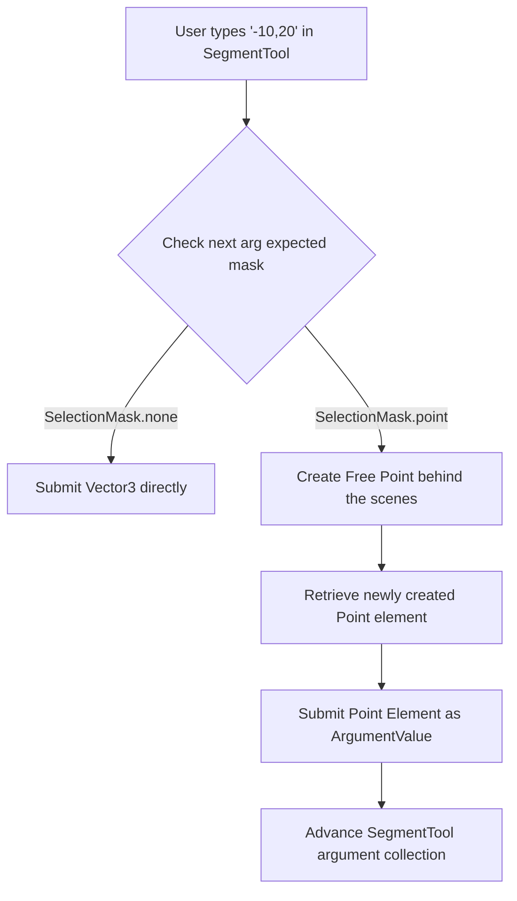

# Architecture Review: Plane Position Input Widget Plan

An in-depth, critical architectural review of the proposed [docs/architecture/plane-position-input-widget-plan.md](docs/architecture/plane-position-input-widget-plan.md).

---

## 1. General Assessment

The core thesis of the plan is outstanding: **treating numeric coordinate entry as a secondary input provider for the existing declarative tool argument system** (instead of hardcoding specialized coordinate tools or command shortcuts) is an elegant, highly idiomatic approach. It fits beautifully into the multi-argument validation and execution architecture defined in [frontend/src/tools/ToolArgumentCollector.ts](frontend/src/tools/ToolArgumentCollector.ts).

However, the plan has a few critical oversights, UX/shortcut conflicts, opportunities for significantly better UX with low friction, and interface-segregation issues that need refinement before writing production code.

---

## 2. High-Severity Integration Conflicts & Oversights

### 2.1. The Global `Escape` Collision (Critical Bug)
The plan states:
> "Escape clears the input if it has text. If the input is empty, Escape falls through to the existing tool-cancel behavior."

Currently, [frontend/src/application/appShell/KeyboardShortcutRouter.ts](frontend/src/application/appShell/KeyboardShortcutRouter.ts#L36-L41) intercepts Keydown events on the global `window` object and has this behavior:
```typescript
if (event.key === 'Escape') {
  event.preventDefault();
  this.deps.toolStore.setTool('select');
  this.deps.selection.clearSelection();
  return;
}
```
Because the shortcut router lacks an early return or condition for focused text inputs when handling `Escape`, **pressing Escape inside the coordinate widget will immediately switch the tool to select mode and clear the selection, rather than clearing the text or canceling input.**

*   **Mitigation**: The global router must be corrected to check if a text input (or specifically the coordinate input) is focused before intercepting `Escape`.

### 2.2. Shortcut Focus Trap & Modifier Collisions on `+`/`-`
The plan advises keeping the coordinate input focused after point creation in `PointTool` to facilitate rapid coordinate entry, and suggests routing `+` and `-` as "coordinate starter keys."

1.  **Hotkey Hijacking**: If the widget keeps focus, the user is trapped in coordinate entry. Standard tool hotkeys (like `P` for Point, `L` for Line, `C` for Circle, `S` for Segment, or `G` for Guide) will be typed into the input field rather than switching tools, requiring a manual, high-friction mouse blur click to escape.
2.  **Zoom Collision & Resolution with Ctrl Modifiers**:
    In drafting and CAD applications, `+` and `-` are standard keys. If bare `+` and `-` are used as zoom shortcuts directly on the canvas, they collide immediately with typing signed coordinates (e.g. `-20, +105`).
    *   **Consistent Standard Solution**: We should explicitly require `Ctrl +` (or `Ctrl =`) for Zooming In and `Ctrl -` for Zooming Out instead of bare keys. This is highly consistent with standard browser controls, existing system shortcuts (like `Ctrl + 0` for fit-to-view), and standard keyboard designs. It entirely eliminates the zoom-vs-negative-coordinate collision.
3.  **Correct Workflow UX**:
    *   The coordinate input should **always blur** and lose focus after a successful submission.
    *   To support rapid entry, typing any digit `0-9` or sign (`-` or `+` when no modifier is pressed) should automatically focus the blurred widget and enter that character. Since zoom requires `Ctrl`, un-modified `-` and `+` are 100% safe to use as coordinate starters.
    *   The keyboard shortcut router should prevent non-starting characters from entering the input, keeping hotkeys like `P`, `L`, `C`, etc. free for tool switching when the widget is blurred.

---

## 3. Short-Sighted Constraints vs. High-Leverage Opportunities

### 3.1. The "Points-on-the-Fly" Creation Opportunity (High-Value Feature)
The plan strictly limits coordinate input to tools whose current argument accepts `SelectionMask.none()`. Since `SegmentTool`, `LineTool`, and `CircleTool` expect existing point elements through `SelectionMask.point()`, coordinates **cannot be entered directly inside these tools**.
To draw a segment between $(-10,20)$ and $(50,80)$, a user must:
1. Switch to `PointTool`.
2. Type `-10,20`, press Enter (creates P1).
3. Type `50,80`, press Enter (creates P2).
4. Switch to `SegmentTool`.
5. Click P1 and P2 on the canvas.

This is a high-friction workflow that severely compromises the utility of typed coordinates.

#### Proposed Solution: Auto-Point Creation on Argument Submission
The framework can be augmented to support "anonymous coordinates" for arguments expecting points.
When a tool has a next argument expecting `SelectionMask.point()`, and the user enters numerical coordinates:
1.  The coordinator intercepts the submission.
2.  The coordinator dispatches an underlying point-creation intent to create a free point element at the specified coordinates.
3.  The newly created point element is retrieved.
4.  The element is instantly fed as the `ArgumentValue` to the active tool, progressing its state seamlessly!

This would allow entering $(-10,20)$ and $(50,80)$ directly inside the `SegmentTool` to produce the segment instantly!



### 3.2. Decimal Localization Oversights
The plan delegates decimal-comma support (e.g. `-20,5;10,2` representing $u = -20.5, v = 10.2$ in European locales) to "Later extensions" and strictly enforces comma separator and dot decimal.
In practice, if standard keypads on European keyboard layouts are used, pressing the decimal key types a localized comma `,`. Not designing the parser's regex or parser factory to cleanly map alternate separators can lead to rapid regressions and localized layout frustrations.

*   **Mitigation**: Ensure the parsing utility is built with a flexible strategy (e.g. trying comma as coordinate separator first, falling back to semicolon if multiple commas or localized formats are detected) under the hood.

---

## 4. Architectural Cleanliness & Refinements

### 4.1. interface Segregation and `ITool` Interface Pollution
The plan proposes adding three optional methods to `ITool.ts`:
```typescript
interface ITool {
  handleClick(context: ToolContext): ToolResult;
  handlePlanePositionInput?(context: ToolContext, position: Vector3): ToolResult;
  acceptsPlanePositionInput?(): boolean;
  getPlanePositionInputLabel?(): string;
}
```
This violates the **Interface Segregation Principle** (ISP) of clean architecture. Only `ArgumentCollectorTool` subclasses need coordinate-input capabilities. Poluting `ITool` for all tools introduces unnecessary optional properties.

#### Recommended Refactoring: Intermediate Interface
Declare a specialized coordinate-handling interface:
```typescript
export interface ICoordinateCapableTool extends ITool {
  handlePlanePositionInput(context: ToolContext, position: Vector3): ToolResult;
  acceptsPlanePositionInput(): boolean;
  getPlanePositionInputLabel(): string;
}
```
Inside [frontend/src/application/canvas/CanvasInteractionController.ts](frontend/src/application/canvas/CanvasInteractionController.ts), check if the current tool satisfies this interface (e.g. checking if the current tool is an instance of `ArgumentCollectorTool` or has `handlePlanePositionInput` property) before updating state or sending coordinates.

### 4.2. State Bubbling vs. Global Store Lifecycle
The plan proposes:
1. `SvgCanvas.vue` maintaining coordinate input state.
2. `SvgCanvas.vue` emitting `update-plane-position-input-state` up to `App.vue`.
3. `App.vue` passing state down to `StatusBar.vue`.
4. `StatusBar.vue` forwarding state to child components.

This introduces boilerplate event bubbles and prop-drilling in the presenter layer.
Since Vue 3 has clean Composition API stores (such as [frontend/src/stores/toolStore.ts](frontend/src/stores/toolStore.ts)), a cleaner, state-driven alternative is to put this visual configuration directly into the store or a lightweight coordinate store, or provide the state reactively from the upper injection keys.

---

## 5. Summary of Recommended Implementation Tasks

Add these tasks to the final testing and architecture plan to ensure a rock-solid dev cycle:

1.  **Refactor global shortcuts**:
    - Fix the Esc focus bug in [frontend/src/application/appShell/KeyboardShortcutRouter.ts](frontend/src/application/appShell/KeyboardShortcutRouter.ts) to ignore app hotkeys and Esc tool resets when an input target has focus.
    - Wire `Ctrl +` (or `Ctrl =`) for zoom-in and `Ctrl -` for zoom-out into [frontend/src/application/appShell/KeyboardShortcutRouter.ts](frontend/src/application/appShell/KeyboardShortcutRouter.ts) under the modifier section, and remove any bare key zoom actions on canvas to prevent conflicts with signed coordinate inputs.
2.  **Define a Clean Coordinate Interface**: Ensure `ITool` is not polluted; use `ICoordinateCapableTool` pattern or safe type-guards.
3.  **Design an Adaptable Parser**: Test parsing on edge-cases such as extra whitespaces, optional parentheses, sign characters, and localized formats.
4.  **Auto-blur focus lifecycle**: Implement automatic input blur with instant digit-triggered re-focus to avoid trapping the keyboard.
5.  **Expand Point-on-the-fly integration**: Enable coordinate entry inside multiple-point tools as an advanced phase, unlocking high-value CAD capabilities.
6.  **E2E Integration Coverage**: Write Vitest/Playwright tests covering typing coordinates into the status bar, parsing correct coordinate points, error feedbacks, and hotkey routing behaviors.
