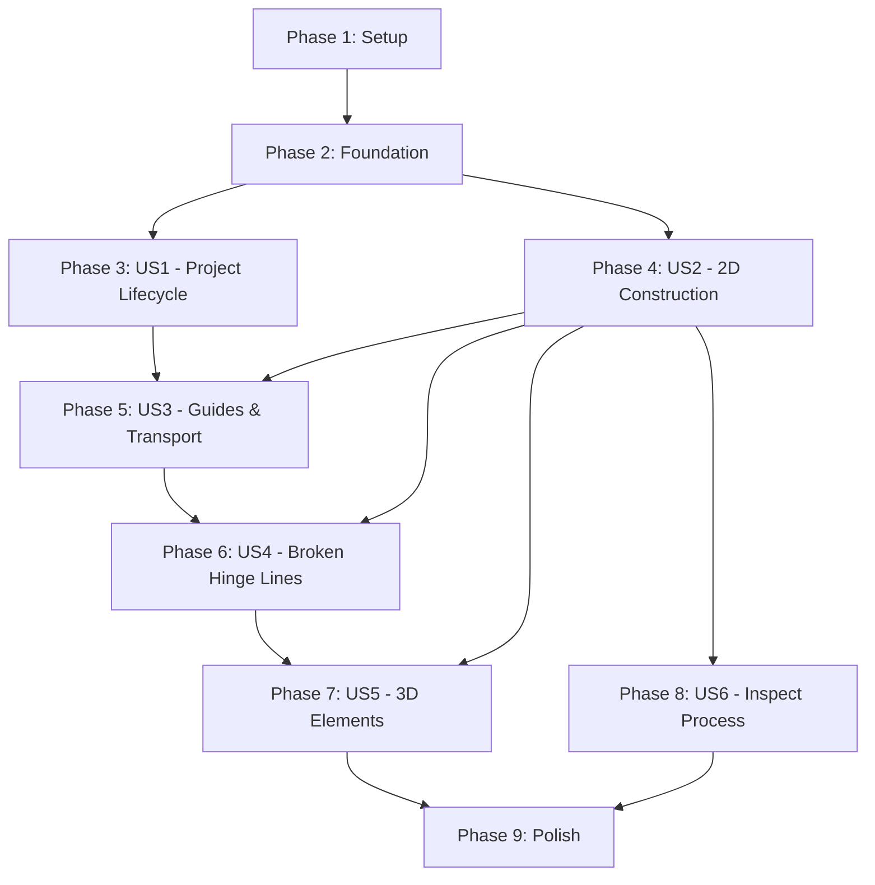

# Tasks: Diedrico Dihedral Learning MVP

**Input**: Design documents from `/specs/001-dihedral-learning-mvp/`
**Prerequisites**: plan.md, spec.md, data-model.md, contracts/, research.md

**Tests**: Per Diedrico Constitution (Principle V: Test-Driven Development), tests are MANDATORY for this feature.

**Organization**: Tasks are grouped by user story to enable independent implementation and testing of each story.

**Constitution Compliance**: All tasks MUST respect:
- Layered Architecture (Principle I) - No cross-layer violations
- Command Pattern (Principle II) - User actions as commands with incremental execution
- Frontend-First (Principle III) - All business logic in frontend
- Technology Discipline (Principle IV) - Vue.js 3, TypeScript, Node.js backend

---

## Format: `- [ ] [ID] [P?] [Story] Description with file path`

- **[P]**: Can run in parallel (different files, no dependencies)
- **[Story]**: Which user story this task belongs to (e.g., US1, US2, US3)

---

## Phase 1: Setup & Infrastructure

**Goal**: Establish project structure, development environment, and architectural foundation

### Tasks

- [X] T001 [P] Create repository structure with frontend/, backend/, specs/ directories
- [X] T002 [P] Initialize frontend package.json with Vue 3, Vite, TypeScript, Pinia dependencies in frontend/
- [X] T003 [P] Initialize backend package.json with Express, TypeScript dependencies in backend/
- [X] T004 [P] Create frontend/tsconfig.json with ES2020+ target and strict mode
- [X] T005 [P] Create backend/tsconfig.json with Node 18+ target
- [X] T006 [P] Create frontend/vite.config.ts with Vue plugin configuration
- [X] T007 [P] Create backend/src/server.ts with Express app initialization
- [X] T008 [P] Create backend/src/api/health.ts with GET /api/health endpoint
- [X] T009 [P] Create frontend/src/main.ts with Vue app initialization
- [X] T010 [P] Create frontend/src/App.vue with empty workspace shell
- [X] T011 Create npm scripts for dev, build, test in root package.json using workspaces
- [X] T012 [P] Create Vitest configuration in frontend/vitest.config.ts
- [X] T013 [P] Create first smoke test in frontend/tests/unit/smoke.spec.ts
- [X] T014 Verify `npm run dev` starts both frontend and backend successfully

---

## Phase 2: Foundational Tasks (Blocking Prerequisites)

**Goal**: Implement core domain models, geometry calculations, and command pattern infrastructure that all user stories depend on

### Tasks

- [X] T015 [P] Create frontend/src/types/ElementTypes.ts with Element2D and Element3D union types
- [X] T016 [P] Create frontend/src/types/CommandTypes.ts with CommandStatus enum and OperationResult interface
- [X] T017 [P] Create frontend/src/types/ResultTypes.ts with Result<T, E> type for error handling
- [ ] T018 [P] Create frontend/src/domain/world/Element2D.ts with Point2D, Segment2D, Line2D, Circle2D interfaces
- [ ] T019 [P] Create frontend/src/domain/world/Element3D.ts with Point3D, Line3D, Segment3D interfaces
- [X] T020 [P] Create frontend/src/domain/world/VisualStyle.ts with color, lineWidth, lineStyle properties
- [X] T021 [P] Create frontend/src/domain/viewState/ProjectionPlane.ts with plane definition and coordinate system
- [X] T022 [P] Create frontend/src/domain/viewState/HingeLine.ts with hinge line entity
- [X] T023 [P] Create frontend/src/domain/world/DependencyGraph.ts with DAG structure and traversal methods
- [X] T024 [P] Create frontend/src/domain/processTree/Process.ts with root process node
- [X] T025 [P] Create frontend/src/domain/processTree/Subprocess.ts with subprocess container
- [X] T026 [P] Create frontend/src/domain/processTree/ActionGroup.ts with action group (no name field)
- [X] T027 [P] Create frontend/src/domain/processTree/Action.ts with ConstructiveAction and DerivedAction
- [X] T028 [P] Create frontend/src/domain/calculations/intersections.ts with line-line intersection functions
- [X] T029 [P] Create frontend/src/domain/calculations/perpendiculars.ts with perpendicular construction functions
- [X] T030 [P] Create frontend/src/domain/calculations/distances.ts with point-line, point-point distance functions
- [X] T031 [P] Write unit tests for intersections.ts in frontend/tests/unit/calculations/intersections.spec.ts
- [X] T032 [P] Write unit tests for perpendiculars.ts in frontend/tests/unit/calculations/perpendiculars.spec.ts
- [X] T033 [P] Write unit tests for distances.ts in frontend/tests/unit/calculations/distances.spec.ts
- [X] T034 [P] Create frontend/src/commands/OperationResult.ts with outputs: Record<string, any> interface
- [X] T035 [P] Create frontend/src/commands/Command.ts with addAndExecute(), commit(), rollback() methods
- [X] T036 [P] Create frontend/src/commands/CommandStack.ts with undo/redo history management
- [X] T037 [P] Create frontend/src/commands/operations/WorldOperations.ts with AddElementOp, RemoveElementOp, UpdateElementOp
- [X] T038 [P] Create frontend/src/commands/operations/ProcessTreeOperations.ts with AddSubprocessOp, AddActionGroupOp, AddActionToGroupOp
- [X] T039 [P] Create frontend/src/commands/operations/ViewStateOperations.ts with SetActivePlaneOp, UpdateView2DOp
- [X] T040 [P] Create frontend/src/commands/operations/DependencyOperations.ts with AddDependencyEdgesOp, RemoveDependencyEdgesOp
- [X] T041 [P] Write unit tests for Command.ts incremental execution in frontend/tests/unit/commands.spec.ts
- [X] T042 [P] Write unit tests for CommandStack.ts undo/redo in frontend/tests/unit/commandStack.spec.ts
- [X] T043 [P] Create frontend/src/stores/worldStore.ts with elements2D, elements3D, dependencyGraph state
- [X] T044 [P] Create frontend/src/stores/processStore.ts with ProcessTree and command history state
- [X] T045 [P] Create frontend/src/stores/viewStore.ts with active plane and view state
- [X] T046 [P] Create frontend/src/stores/toolStore.ts with active tool state
- [X] T047 [P] Create frontend/src/utils/idGenerator.ts with ID generation utilities
- [X] T048 [P] Create frontend/src/services/GeometryService.ts wrapping calculation functions
- [X] T049 [P] Create frontend/src/services/DependencyService.ts with recomputation and topological sort
- [X] T050 [P] Create frontend/src/services/ValidationService.ts with infeasibility checks

---

## Phase 3: User Story 1 - Project Lifecycle (Priority P1)

**Story Goal**: Create, save, and reopen projects with persistence

**Independent Test Criteria**: Can create a new drawing, add elements, save, reopen, and verify all planes/elements/actions and view settings are restored.

### Tasks

- [X] T051 [US1] Create backend/src/models/Project.ts with Project DTO interface
- [X] T052 [US1] Create backend/src/storage/FileStorage.ts with JSON file read/write operations in backend/data/projects/
- [X] T053 [US1] Create backend/src/storage/ProjectRepository.ts with CRUD operations using FileStorage
- [X] T054 [US1] Create backend/src/api/projects.ts with GET /api/projects endpoint to list all projects
- [X] T055 [US1] Implement POST /api/projects endpoint to create new project with default planes (P_H, P_V, HL_HV) in backend/src/api/projects.ts
- [X] T056 [US1] Implement GET /api/projects/:id endpoint to load project by ID in backend/src/api/projects.ts
- [X] T057 [US1] Implement PUT /api/projects/:id endpoint to save project with updated timestamp in backend/src/api/projects.ts
- [X] T058 [US1] Implement DELETE /api/projects/:id endpoint in backend/src/api/projects.ts
- [X] T059 [US1] Create frontend/src/services/ProjectService.ts with methods calling backend API
- [X] T060 [US1] Implement debounced autosave (500ms) in ProjectService.ts
- [X] T061 [US1] Implement project deserialization and domain object reconstruction in ProjectService.ts
- [X] T062 [US1] Create frontend/src/components/dialogs/NewProjectDialog.vue with project name input
- [X] T063 [US1] Create frontend/src/components/dialogs/OpenProjectDialog.vue with project list
- [X] T064 [US1] Implement "New Project" action that creates project with default planes and HL_HV
- [X] T065 [US1] Implement "Open Project" action that loads and deserializes project state
- [X] T066 [US1] Write integration test for POST /api/projects in backend/tests/integration/projects.spec.ts
- [X] T067 [US1] Write integration test for GET /api/projects/:id in backend/tests/integration/projects.spec.ts
- [X] T068 [US1] Write integration test for PUT /api/projects/:id in backend/tests/integration/projects.spec.ts
- [X] T069 [US1] Write E2E test for create/save/reload cycle in frontend/tests/e2e/persistence.spec.ts
- [X] T070 [US1] Verify autosave triggers after 500ms of inactivity

---

## Phase 4: User Story 2 - Build 2D Dihedral Construction (Priority P1)

**Story Goal**: Create explicit 2D geometric constructions on projection planes with parametric updates

**Independent Test Criteria**: Can create points/segments/lines/circles on active plane, modify base elements, and verify dependent elements update or become infeasible.

### Workspace & Basic Tools

- [X] T071 [US2] Create frontend/src/components/workspace/Workspace2D.vue with SVG canvas
- [X] T072 [US2] Implement D3.js zoom/pan behavior in Workspace2D.vue (Shift+drag pan, wheel zoom)
- [X] T073 [US2] Create frontend/src/components/workspace/ElementRenderer.vue to render Point2D, Segment2D as SVG
- [X] T074 [US2] Create frontend/src/components/toolbars/MainToolbar.vue with tool selector buttons
- [X] T075 [US2] Create frontend/src/components/toolbars/PlaneSelector.vue with active plane toggle (P_H, P_V)
- [X] T076 [US2] Implement active plane selection logic in viewStore.ts
- [X] T077 [US2] Create frontend/src/composables/useSnapping.ts for point snapping within radius
- [X] T078 [US2] Create frontend/src/composables/useHoverHighlight.ts for dependency highlighting
- [X] T079 [US2] Create frontend/src/composables/useToolFeedback.ts for visual feedback during tool use
- [X] T080 [US2] Create frontend/src/composables/useCommandExecution.ts for command building and commit

### Point Tools

- [ ] T081 [P] [US2] Create CreateFreePointCommand in frontend/src/commands/CreateFreePointCommand.ts
- [ ] T082 [P] [US2] Implement free point tool handler that builds command with AddElementOp for Point2D
- [ ] T083 [P] [US2] Create CreatePointOnElementCommand in frontend/src/commands/CreatePointOnElementCommand.ts
- [ ] T084 [P] [US2] Implement point-on-element tool with closest point projection calculation
- [ ] T085 [P] [US2] Create CreateIntersectionPointCommand in frontend/src/commands/CreateIntersectionPointCommand.ts
- [ ] T086 [P] [US2] Implement automatic intersection point creation on element click (FR-023)
- [ ] T087 [P] [US2] Write unit tests for CreateFreePointCommand in frontend/tests/unit/commands/createFreePoint.spec.ts
- [ ] T088 [P] [US2] Write unit tests for CreateIntersectionPointCommand in frontend/tests/unit/commands/createIntersectionPoint.spec.ts

### Segment/Line Tools

- [ ] T089 [P] [US2] Create CreateSegmentCommand in frontend/src/commands/CreateSegmentCommand.ts
- [ ] T090 [P] [US2] Implement segment tool: click two points → addAndExecute AddElementOp for Segment2D
- [ ] T091 [P] [US2] Create CreateLineCommand in frontend/src/commands/CreateLineCommand.ts
- [ ] T092 [P] [US2] Implement line tool variants: by two points, parallel through point, perpendicular through point
- [ ] T093 [P] [US2] Add validation for coincident points (infeasible segment) in CreateSegmentCommand
- [ ] T094 [P] [US2] Write unit tests for CreateSegmentCommand validation in frontend/tests/unit/commands/createSegment.spec.ts
- [ ] T095 [P] [US2] Write unit tests for CreateLineCommand variants in frontend/tests/unit/commands/createLine.spec.ts

### Circle/Arc Tools

- [ ] T096 [P] [US2] Create CreateCircleCommand in frontend/src/commands/CreateCircleCommand.ts
- [ ] T097 [P] [US2] Implement circle tool variants: center+radius, center+point, three points
- [ ] T098 [P] [US2] Add validation for collinear points (infeasible circle from 3 points) in CreateCircleCommand
- [ ] T099 [P] [US2] Write unit tests for CreateCircleCommand validation in frontend/tests/unit/commands/createCircle.spec.ts

### Dependency & Recomputation

- [ ] T100 [US2] Implement dependency graph edge creation when elements are constructed
- [ ] T101 [US2] Implement parametric recomputation in DependencyService.ts with topological sort
- [ ] T102 [US2] Implement infeasibility propagation in ValidationService.ts
- [ ] T103 [US2] Implement infeasible element rendering (red dashed lines, not drawn) in ElementRenderer.vue
- [ ] T104 [US2] Write unit tests for dependency graph traversal in frontend/tests/unit/dependencyGraph.spec.ts
- [ ] T105 [US2] Write unit tests for recomputation logic in frontend/tests/unit/dependencyService.spec.ts

### Actions & Elements Panels

- [ ] T106 [P] [US2] Create frontend/src/components/panels/ActionsPanel.vue to display command history
- [ ] T107 [P] [US2] Implement action list rendering with timestamp, type, and outputs in ActionsPanel.vue
- [ ] T108 [P] [US2] Implement collapsible auxiliary actions (ActionGroups) in ActionsPanel.vue
- [ ] T109 [P] [US2] Create frontend/src/components/panels/ElementsPanel.vue with 2D/3D sections
- [ ] T110 [P] [US2] Implement element grouping by type (points, segments, lines, circles) in ElementsPanel.vue
- [ ] T111 [P] [US2] Implement element click → open properties dialog in ElementsPanel.vue
- [ ] T112 [P] [US2] Create frontend/src/components/dialogs/ElementPropertiesDialog.vue for visual style editing

### E2E Tests

- [ ] T113 [US2] Write E2E test for basic construction: create points, segment, verify in panel in frontend/tests/e2e/basic-construction.spec.ts
- [ ] T114 [US2] Write E2E test for parametric update: move point, verify segment updates in frontend/tests/e2e/parametric-update.spec.ts
- [ ] T115 [US2] Write E2E test for infeasibility: create infeasible segment, verify not drawn in frontend/tests/e2e/infeasibility.spec.ts
- [ ] T116 [US2] Write E2E test for navigation during tool: pan/zoom doesn't cancel tool in frontend/tests/e2e/navigation.spec.ts
- [ ] T117 [US2] Verify performance: navigation <200ms for 200 elements (SC-002)

---

## Phase 5: User Story 3 - Dihedral Guides and Transports (Priority P2)

**Story Goal**: Create guides perpendicular to hinge lines and transport points/distances between planes

**Independent Test Criteria**: Can create guide from HL and point, transport point via guide, verify transported result is derived and tracked as action.

### Guide Creation

- [ ] T118 [US3] Create CreateGuideCommand in frontend/src/commands/CreateGuideCommand.ts
- [ ] T119 [US3] Implement guide creation: select HL + point → compute perpendicular on both planes
- [ ] T120 [US3] Store guide as belonging to both planes in worldStore.ts
- [ ] T121 [US3] Render guide on both planes in ElementRenderer.vue
- [ ] T122 [US3] Write unit tests for CreateGuideCommand in frontend/tests/unit/commands/createGuide.spec.ts

### Transport Operations

- [ ] T123 [P] [US3] Create TransportPointCommand in frontend/src/commands/TransportPointCommand.ts
- [ ] T124 [P] [US3] Implement transport point: given guide + point on plane1 → create derived point on plane2
- [ ] T125 [P] [US3] Mark transported point as derived (lighter color, 50% opacity) in VisualStyle
- [ ] T126 [P] [US3] Create TransportDistanceCommand in frontend/src/commands/TransportDistanceCommand.ts
- [ ] T127 [P] [US3] Implement transport distance: given guide + two points → create distance on other plane
- [ ] T128 [P] [US3] Write unit tests for TransportPointCommand in frontend/tests/unit/commands/transportPoint.spec.ts
- [ ] T129 [P] [US3] Write unit tests for TransportDistanceCommand in frontend/tests/unit/commands/transportDistance.spec.ts

### E2E Tests

- [ ] T130 [US3] Write E2E test for guide creation from HL and point in frontend/tests/e2e/guide-creation.spec.ts
- [ ] T131 [US3] Write E2E test for point transport via guide in frontend/tests/e2e/point-transport.spec.ts
- [ ] T132 [US3] Verify transported elements have derived visual style

---

## Phase 6: User Story 4 - Broken Hinge Lines (BHL) (Priority P2)

**Story Goal**: Create 3D planes, see BHL projections auto-appear, create guides on BHL that auto-transport

**Independent Test Criteria**: Can create 3D plane from traces, verify BHL projections appear on both projection planes, create guide on BHL, verify auto-transport to other plane.

### BHL Infrastructure

- [ ] T133 [US4] Extend Element2D types to include BHL projection line type in frontend/src/domain/world/Element2D.ts
- [ ] T134 [US4] Create BrokenHingeLine entity in frontend/src/domain/world/BrokenHingeLine.ts
- [ ] T135 [US4] Implement BHL projection calculation in frontend/src/domain/calculations/bhlProjections.ts
- [ ] T136 [US4] Write unit tests for BHL projection calculations in frontend/tests/unit/calculations/bhlProjections.spec.ts

### 3D Plane Creation with BHL

- [ ] T137 [US4] Create Create3DPlaneCommand in frontend/src/commands/Create3DPlaneCommand.ts
- [ ] T138 [US4] Implement 3D plane creation from two trace lines on different planes
- [ ] T139 [US4] Auto-create BHL projections as Element2D lines when 3D plane is created
- [ ] T140 [US4] Store BHL projections in worldStore and link to parent 3D plane
- [ ] T141 [US4] Render BHL projections on both planes in ElementRenderer.vue
- [ ] T142 [US4] Write unit tests for Create3DPlaneCommand in frontend/tests/unit/commands/create3DPlane.spec.ts

### Guide on BHL with Auto-Transport

- [ ] T143 [US4] Extend CreateGuideCommand to support BHL projection as input
- [ ] T144 [US4] Implement auto-transport: guide created on one BHL projection appears on other
- [ ] T145 [US4] Ensure guide perpendicular to both BHL projections
- [ ] T146 [US4] Update parametric recomputation: when trace changes, BHL updates, guides adjust
- [ ] T147 [US4] Write unit tests for BHL guide auto-transport in frontend/tests/unit/commands/bhlGuide.spec.ts

### E2E Tests

- [ ] T148 [US4] Write E2E test for 3D plane creation and BHL projection appearance in frontend/tests/e2e/bhl-creation.spec.ts
- [ ] T149 [US4] Write E2E test for guide on BHL with auto-transport in frontend/tests/e2e/bhl-guide.spec.ts
- [ ] T150 [US4] Write E2E test for trace modification triggering BHL update in frontend/tests/e2e/bhl-parametric.spec.ts

---

## Phase 7: User Story 5 - 3D Elements and Visualization (Priority P3)

**Story Goal**: Define 3D points/lines/segments from 2D projections, view in read-only 3D overlay

**Independent Test Criteria**: Can select compatible 2D projections to create 3D point, observe in 3D view, verify 3D elements cannot be edited directly.

### 3D Element Creation

- [ ] T151 [US5] Create Create3DPointCommand in frontend/src/commands/Create3DPointCommand.ts
- [ ] T152 [US5] Implement 3D point creation: select projectionH + projectionV → compute 3D coordinates
- [ ] T153 [US5] Add compatibility validation (FR-022): check projections are transportable
- [ ] T154 [US5] Create Create3DLineCommand in frontend/src/commands/Create3DLineCommand.ts
- [ ] T155 [US5] Implement 3D line creation from compatible 2D projections
- [ ] T156 [US5] Create Create3DSegmentCommand in frontend/src/commands/Create3DSegmentCommand.ts
- [ ] T157 [US5] Implement 3D segment creation from two compatible 2D segments
- [ ] T158 [US5] Write unit tests for Create3DPointCommand validation in frontend/tests/unit/commands/create3DPoint.spec.ts

### 3D Workspace

- [ ] T159 [P] [US5] Create frontend/src/components/workspace/Workspace3D.vue with Three.js scene
- [ ] T160 [P] [US5] Initialize Three.js scene, camera, renderer in Workspace3D.vue
- [ ] T161 [P] [US5] Implement OrbitControls for rotate/pan/zoom in Workspace3D.vue
- [ ] T162 [P] [US5] Render projection planes as translucent surfaces in Workspace3D.vue
- [ ] T163 [P] [US5] Render 3D points as spheres in Workspace3D.vue
- [ ] T164 [P] [US5] Render 3D lines/segments as line primitives in Workspace3D.vue
- [ ] T165 [P] [US5] Implement read-only enforcement: disable selection/editing in 3D view
- [ ] T166 [P] [US5] Add toggle: show 2D elements on planes in 3D view
- [ ] T167 [P] [US5] Add toggle: show linking visuals (dashed lines from 2D projections to 3D elements)

### E2E Tests

- [ ] T168 [US5] Write E2E test for 3D point creation from compatible projections in frontend/tests/e2e/3d-creation.spec.ts
- [ ] T169 [US5] Write E2E test for incompatible projection rejection in frontend/tests/e2e/3d-incompatible.spec.ts
- [ ] T170 [US5] Write E2E test for read-only 3D view interaction in frontend/tests/e2e/3d-readonly.spec.ts
- [ ] T171 [US5] Verify 3D view maintains 30+ fps with 50 elements

---

## Phase 8: User Story 6 - Inspect Process and Dependencies (Priority P4)

**Story Goal**: Review construction history, explore dependencies via hover highlighting

**Independent Test Criteria**: Can hover actions/elements in panels and verify focus/ancestors/descendants highlights are consistent.

### Hover Highlighting

- [ ] T172 [US6] Implement hover highlighting in ActionsPanel: hover action → highlight focus/inputs/outputs in workspace
- [ ] T173 [US6] Implement hover highlighting in ElementsPanel: hover element → highlight focus/ancestors/descendants
- [ ] T174 [US6] Apply CSS classes: .focus, .ancestor, .descendant, .infeasible in ElementRenderer.vue
- [ ] T175 [US6] Implement temporary highlighting: clear on mouseleave
- [ ] T176 [US6] Add toggle: "Enable dependency hover" checkbox in settings
- [ ] T177 [US6] Add slider: "Snap radius" control in settings
- [ ] T178 [US6] Write unit tests for dependency highlighting logic in frontend/tests/unit/hoverHighlight.spec.ts

### Visual Styles

- [ ] T179 [P] [US6] Implement visual style editing in ElementPropertiesDialog.vue (color, lineWidth, lineStyle)
- [ ] T180 [P] [US6] Implement style inheritance from subprocess in VisualStyle computation
- [ ] T181 [P] [US6] Add "Reset to inherited" button for each style property
- [ ] T182 [P] [US6] Implement explicit override indicator (bold label when overridden)
- [ ] T183 [P] [US6] Write unit tests for style inheritance in frontend/tests/unit/visualStyle.spec.ts

### E2E Tests

- [ ] T184 [US6] Write E2E test for hover highlighting in action panel in frontend/tests/e2e/hover-action.spec.ts
- [ ] T185 [US6] Write E2E test for hover highlighting in element panel in frontend/tests/e2e/hover-element.spec.ts
- [ ] T186 [US6] Write E2E test for visual style editing in frontend/tests/e2e/style-editing.spec.ts
- [ ] T187 [US6] Verify hover highlighting response time <200ms for 200 elements (SC-002)

---

## Phase 9: Polish & Cross-Cutting Concerns

**Goal**: Address edge cases, performance optimization, and final polish

### Edge Case Handling

- [ ] T188 [P] Implement cascading infeasibility: base change makes multiple downstream actions infeasible
- [ ] T189 [P] Handle switching active plane mid-operation: complete/cancel deterministically
- [ ] T190 [P] Handle opening drawing with infeasible actions: clearly indicate in panels
- [ ] T191 [P] Handle toggling plane visibility while tool is active: maintain tool state
- [ ] T192 [P] Write E2E test for cascading infeasibility in frontend/tests/e2e/cascading-infeasibility.spec.ts

### Performance Optimization

- [ ] T193 [P] Profile 2D navigation with 200 elements, optimize if >200ms
- [ ] T194 [P] Implement spatial indexing (R-tree) if intersection detection slow
- [ ] T195 [P] Implement virtual scrolling in panels if >1000 elements
- [ ] T196 [P] Add memoization for expensive geometry calculations in GeometryService.ts
- [ ] T197 [P] Optimize recomputation: only recompute affected subgraph, not entire graph

### Documentation

- [ ] T198 [P] Update README with screenshots and setup instructions
- [ ] T199 [P] Create user guide in docs/user-guide.md with basic usage examples
- [ ] T200 [P] Document developer onboarding in docs/developer-guide.md
- [ ] T201 [P] Add code comments for complex algorithms (recomputation, BHL projections)

---

## Dependencies

### User Story Completion Order

**Critical Path**: Setup → Foundation → US2 (2D Construction) → US3 (Guides) → US4 (BHL) → US5 (3D) → Polish

**Independent Stories**: US1 (Project Lifecycle) can be developed in parallel with US2 after Foundation is complete.

---

## Parallel Execution Opportunities

### Phase 1: Setup & Infrastructure
- Tasks T001-T010 can all run in parallel (different configuration files)
- T013 depends on T012 (Vitest config must exist)

### Phase 2: Foundational Tasks
- Domain model tasks (T015-T027) can run in parallel
- Calculation functions (T028-T030) can run in parallel
- Unit tests (T031-T033) can run in parallel after their implementations
- Command infrastructure (T034-T040) can run in parallel
- Store creation (T043-T046) can run in parallel
- Service creation (T047-T050) can run in parallel

### Phase 3: User Story 1
- Backend API endpoints (T054-T058) can run in parallel after T053
- Frontend service and dialogs (T059-T063) can run in parallel
- Integration tests (T066-T068) can run in parallel after implementations

### Phase 4: User Story 2
- Point tool commands (T081, T083, T085) can run in parallel
- Segment/Line commands (T089, T091) can run in parallel
- Tests for commands (T087, T088, T094, T095, T099) can run in parallel
- Panel components (T106, T109) can run in parallel

### Phase 5: User Story 3
- Transport commands (T123, T126) can run in parallel after T122
- Tests (T128, T129) can run in parallel after implementations

### Phase 6: User Story 4
- BHL infrastructure tasks (T133-T136) can run in parallel

### Phase 7: User Story 5
- 3D workspace rendering tasks (T159-T167) can run in parallel after T160

### Phase 8: User Story 6
- Visual style tasks (T179-T183) can run in parallel with hover highlighting tasks (T172-T177)

### Phase 9: Polish
- Edge case handling (T188-T191) can run in parallel
- Performance optimization (T193-T197) can run in parallel
- Documentation (T198-T201) can run in parallel

---

## Implementation Strategy

### MVP First (Minimum Viable Product)
**Scope**: Phase 1-4 (Setup + Foundation + US1 + US2)
- Establishes core infrastructure
- Delivers basic 2D construction capability
- Enables project persistence
- Provides foundation for advanced features

**Timeline**: ~5-6 weeks
**Outcome**: Working application where users can create, save, and manipulate 2D constructions

### Incremental Delivery

1. **MVP Release** (Phases 1-4)
   - Users can create 2D constructions
   - Projects persist across sessions
   - Parametric updates work
   - Infeasibility is detected

2. **Dihedral Tools Release** (Phases 5-6)
   - Add guide and transport operations
   - Add broken hinge line support
   - Enables classical dihedral workflows

3. **3D Visualization Release** (Phase 7)
   - Add read-only 3D view
   - Create 3D elements from projections
   - Improve spatial understanding

4. **Polish Release** (Phases 8-9)
   - Add dependency inspection
   - Visual style customization
   - Performance optimization
   - Edge case handling

---

## Format Validation

✅ **All tasks follow required format**: `- [ ] [TaskID] [P?] [Story?] Description with file path`

**Task Statistics**:
- Total tasks: 201
- Setup & Infrastructure: 14 tasks
- Foundational: 36 tasks
- User Story 1 (P1): 20 tasks
- User Story 2 (P1): 47 tasks
- User Story 3 (P2): 15 tasks
- User Story 4 (P2): 18 tasks
- User Story 5 (P3): 21 tasks
- User Story 6 (P4): 16 tasks
- Polish: 14 tasks

**Parallelizable tasks**: 94 tasks marked with [P]

**Suggested MVP Scope**: Phases 1-4 (117 tasks, ~40% parallelizable)

---

## Success Criteria Mapping

| Success Criterion | Related Tasks |
|-------------------|---------------|
| SC-001: Basic exercise <10 min | T113-T117, T130-T132 (E2E tests) |
| SC-002: Navigation <200ms for 200 elements | T117, T187, T193 (performance tests) |
| SC-003: 90% infeasibility identifiable | T103, T115, T192 (infeasibility handling) |
| SC-004: 100% restoration on test set | T069, T070 (persistence tests) |

---

**End of Tasks Document**
